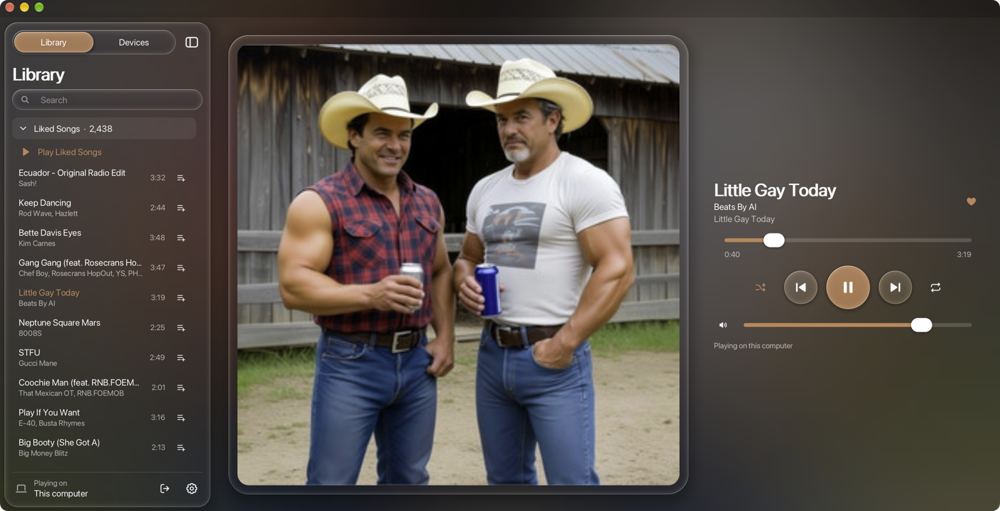
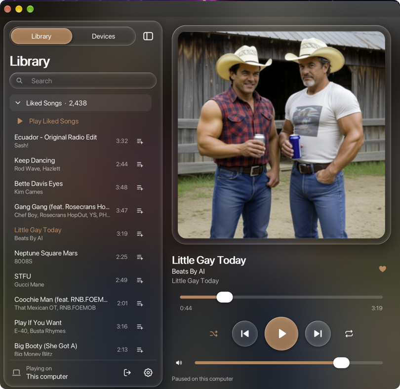
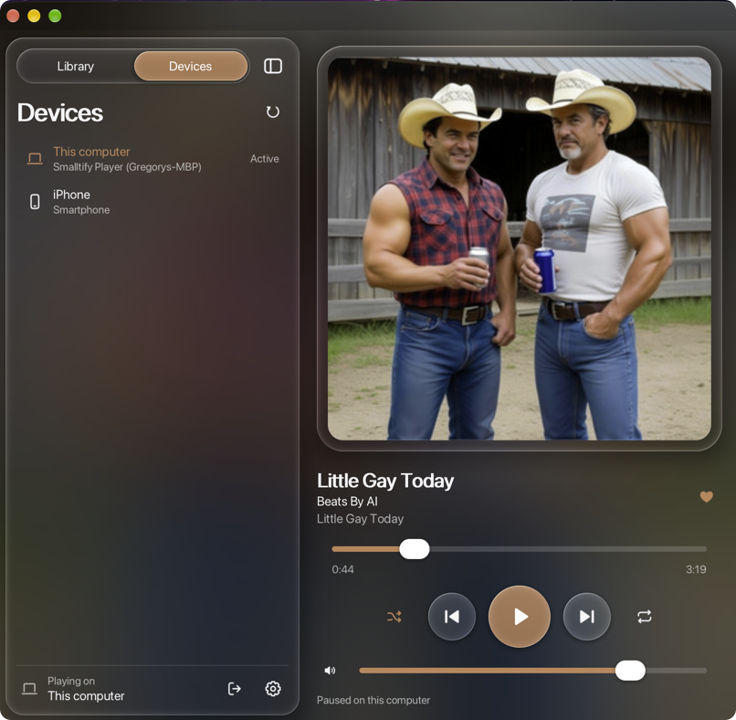
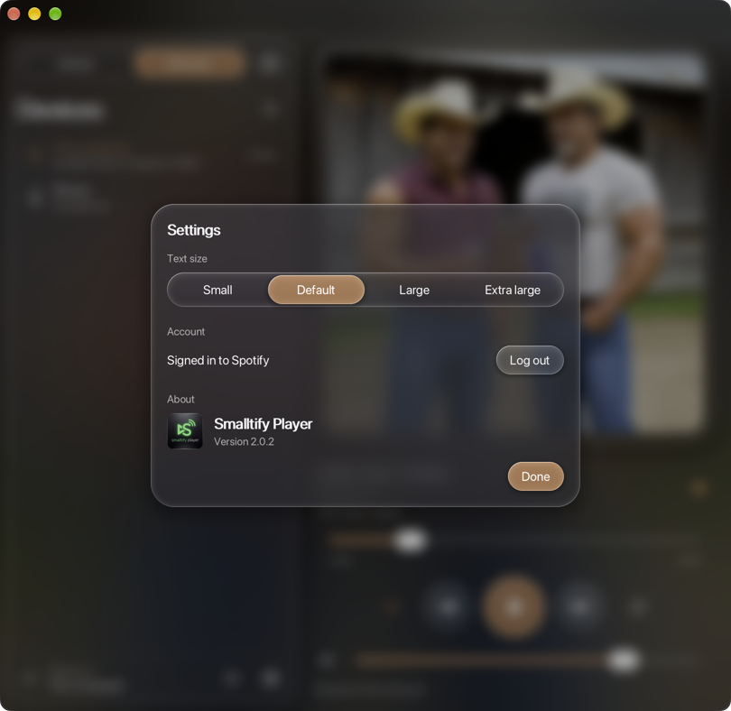

# Smalltify Player

A small, low-power Spotify player and remote for the desktop, written in plain C11. It has a native GUI (Raven) and a command-line interface in one binary. It plays music on your computer through [Spotify Soloist](https://developer.spotify.com/documentation/soloist), Spotify's official headless Spotify Connect client, and it can also control any other Spotify Connect device on your account (phone, speaker, TV).

> **Platform status:** Smalltify Player has only been tested on **macOS** (13 Ventura or newer, Apple silicon). Windows x64 and Linux x64 builds are produced from the same code (see [Releasing](#releasing)), but they have not been run here, so how they behave at run time is untested.

## Screenshots
| Now playing | Library | Devices | Settings |
|---|---|---|---|
|  |  |  |  |

## What it's for
The official Spotify desktop app is a large Chromium-based app that uses a lot of memory and battery. Smalltify Player covers everyday listening with a fraction of the footprint:

- **Lightweight:** one native executable, event-driven UI (about 0% CPU when idle), no web runtime.
- **Plays locally:** streams on this computer through Spotify Soloist once it is paired.
- **Remote control:** play, pause, skip, seek, volume, shuffle, repeat and device transfer for any Spotify Connect device.
- **Library:** Liked Songs, playlists, albums, artists, podcasts, episodes, recently played, the queue and search.
- **Scriptable:** every action is also a CLI command (`smalltify-player now`, `next`, `vol +10`, ...).
- **Self-contained and portable:** everything the app stores lives inside its own folder or app bundle. Delete it to uninstall, or carry the `.app` on a USB drive.

Playback control needs a **Spotify Premium** account.

## Download
Get the file for your system from [Releases](https://github.com/amcnutt1996/Smalltify-Player/releases). Each release lists the SHA-256 of every file in `SHA256SUMS-<version>.txt`.

Releases ship with no Spotify Client ID. The setup screen asks for yours: create a Spotify developer app ([step 2](#2-create-a-spotify-developer-app)), paste its **Client ID** and press **Save**. Then continue with [First launch](#7-first-launch).

### macOS
Needs macOS 13 or newer on Apple silicon.

1. Download `Smalltify-Player-<version>-arm64.dmg`.
2. Open it and drag **Smalltify Player** to **Applications**, or to any folder or drive you can write to (see [Portable](#portable)).
3. Release builds are signed with a Developer ID and notarized by Apple, so macOS opens them without a warning.

### Windows
Needs 64-bit Windows 10 (version 1803 or newer) or Windows 11 on an x64 PC, and a graphics driver with Vulkan support (current NVIDIA, AMD and Intel drivers include it).

1. Download `Smalltify-Player-<version>-windows-x64.zip`.
2. Unzip it anywhere you can write to, such as your user folder or a USB drive, but not `C:\Program Files`: the app keeps its data in its own folder (see [Where the app keeps its files](#where-the-app-keeps-its-files)).
3. Open the `Smalltify-Player-<version>-windows-x64` folder and run `smalltify-player.exe`. It needs no installer and no DLLs.
4. Unless the release notes say the exe is signed, it is unsigned, so SmartScreen warns you the first time ("Windows protected your PC"). Click **More info**, then **Run anyway**.

### Linux
Needs an x86_64 distribution with glibc 2.35 or newer (for example Ubuntu 22.04, Debian 12, Fedora 36 or newer), and:

- `libcurl4` (`libcurl4t64` on Ubuntu 24.04 and newer), `libx11-6` and the Vulkan loader `libvulkan1`. These are the Debian and Ubuntu names; other distributions package the same curl, X11 and Vulkan loader libraries under their own names.
- A working Vulkan driver: Mesa (`mesa-vulkan-drivers` on Debian and Ubuntu) or your GPU vendor's. Without one the window can't open. That's a matter of your system, not something the app can fix; `vulkaninfo --summary` (package `vulkan-tools`) shows whether a driver is found.

1. Download `Smalltify-Player-<version>-linux-x64.tar.gz`.
2. Extract it anywhere you can write to: `tar xzf Smalltify-Player-<version>-linux-x64.tar.gz`.
3. Run `./smalltify-player` inside the `Smalltify-Player-<version>-linux-x64` folder.

The window uses X11; on a Wayland desktop it runs through XWayland. There is no release for Linux on arm64 or 32-bit ARM, but Spotify publishes Soloist for both, so a [native build](#linux-native-build) plays music there too.

## Build from source

### macOS

#### 1. Prerequisites
- macOS 13 or newer. Local playback needs Apple silicon, because Spotify publishes no Soloist build for Intel Macs. On an Intel Mac the app works as a remote only.
- Xcode Command Line Tools (clang, `codesign`, libcurl): `xcode-select --install`
- CMake 3.20 or newer: `brew install cmake`
- Vulkan loader and MoltenVK for the GUI: `brew install vulkan-loader molten-vk`. CMake looks in `/opt/homebrew/lib` and `/usr/local/lib`.
- An internet connection for the first build, because CMake downloads Raven (GUI library, Apache 2.0) at the commit pinned in `CMakeLists.txt`. cJSON and the Inter font are vendored in `third_party/`.

#### 2. Create a Spotify developer app
1. Go to https://developer.spotify.com/dashboard and create an app.
2. Add the redirect URI `http://127.0.0.1:8888/callback`.
3. If the app is in Development mode, add your Spotify account under **User Management**.
4. Copy the app's **Client ID**. You don't need a client secret: sign-in uses PKCE.

#### 3. Get a Soloist API key (for playback on this computer)
Generate a key at https://developer.spotify.com/dashboard/soloist. Keep it secret; the app never logs it. You can skip this step. Without a key the app still controls your other devices, and you can paste a key later (Devices → "Enable playback on this computer"). Spotify publishes Soloist for macOS on Apple silicon, Windows x64, and Linux on x86_64, arm64 and 32-bit ARM; on Intel Macs and Windows on ARM the app is a remote only.

#### 4. Configure `.env`
```sh
git clone https://github.com/amcnutt1996/Smalltify-Player.git
cd Smalltify-Player
cp .env.example .env
```
Edit `.env` and fill in `SPOTIFY_CLIENT_ID=` and, if you have one, `SOLOIST_API_KEY=`. `.env` is git-ignored. A development build copies only these two lines into the app's folder (on macOS, into the app bundle) and never copies a client secret. A release build (see [Releasing](#releasing)) copies neither. You can also leave the ID out and paste it on the setup screen at first launch.

#### 5. Build and test
```sh
cmake -S . -B build
cmake --build build -j
ctest --test-dir build
```
This produces `build/dist/Smalltify Player.app`, signed ad hoc.

#### 6. Install
Drag `build/dist/Smalltify Player.app` to `/Applications` and open it from there, Launchpad or the Dock. Always open the `.app`, because double-clicking the bare `smalltify-player` file inside it opens Terminal.

#### 7. First launch
1. If the app has no Client ID yet, paste yours on the setup screen and press **Save**. Then click **Sign in with Spotify** and approve the request in your browser. The player opens right away.
2. When macOS asks whether "Smalltify Player" may find devices on your local network, click **Allow**. Otherwise Spotify Connect can't see the player.
3. **Pair once.** Spotify lets Soloist sign in only after an official Spotify app on the same network picks it once. Open Spotify on your phone. The app downloads Soloist from Spotify into its folder (Soloist can't be bundled) and starts it. It then shows a tip naming this Mac's device, "Smalltify Player (<Mac name>)". Choose that device once in the phone's Spotify device list. If no other device of your account shows up for 10 minutes, the unpaired Soloist stops again to save battery.
4. Done. The pairing is saved inside the app. From now on, Play streams on this Mac after every restart, with no phone needed. Restarts, rebuilds and Soloist updates keep the pairing; only **Log out** or deleting the app clears it.

### Windows and Linux release builds (Docker)
These scripts build the Windows and Linux release archives inside Docker containers, so they work on any computer with Docker running (Docker Desktop, OrbStack or Docker Engine): macOS, Linux, or Windows with Git Bash or WSL. They need nothing else installed and can be run from any folder:

```sh
packaging/windows/release.sh   # build/release/Smalltify-Player-<version>-windows-x64.zip
packaging/linux/release.sh     # build/release/Smalltify-Player-<version>-linux-x64.tar.gz
```
- Each script first builds its Docker image (`smalltify-build-windows`, `smalltify-build-linux`), then builds the app with the repo mounted, in `build-windows/` or `build-linux/`. Docker keeps the images, so only the first run is slow. On Apple silicon the containers run as linux/amd64 under emulation, which takes longer.
- **Windows:** cross-compiled with MinGW-w64. The image builds libcurl (with Schannel, Windows' own TLS and certificate store) and zlib as static libraries from pinned source versions whose SHA-256 it checks. The exe is linked fully static, so it needs no DLLs. It has no icon or version info yet, and its libcurl has no HTTP/2, so requests use HTTP/1.1. The zip holds one folder, `Smalltify-Player-<version>-windows-x64/`, with `smalltify-player.exe`, `.env`, `LICENSE` and the licenses of what the exe contains: `Inter-LICENSE.txt`, `Raven-LICENSE.txt`, `Raven-NOTICE.txt`, `cJSON-LICENSE.txt`, `curl-LICENSE.txt` and `winpthreads-LICENSE.txt` (the MinGW-w64 runtime).
- **Linux:** built on Ubuntu 22.04 (so it runs on glibc 2.35 or newer) against the distribution's libcurl, and `ctest` runs in the container. The archive holds one folder, `Smalltify-Player-<version>-linux-x64/`, with `smalltify-player`, `.env`, `LICENSE`, `Inter-LICENSE.txt`, `Raven-LICENSE.txt`, `Raven-NOTICE.txt` and `cJSON-LICENSE.txt`.
- Both ship `.env.example` unchanged as `.env` (no Client ID, no Soloist key), leave the files in `build/release/` owned by you, check the archive's contents and print its SHA-256.
- **Windows signing (optional):** set `SMP_WIN_SIGN_PFX` to the path of a code-signing `.pfx` file and `SMP_WIN_SIGN_PASS` to its password, and the script signs the exe with Authenticode (`osslsigncode`, with an RFC 3161 timestamp). Without them the exe is unsigned and SmartScreen warns whoever runs it.

### Linux native build
To build and run on your own Linux machine (any architecture, including arm64 and 32-bit ARM). On Debian or Ubuntu:

```sh
sudo apt install build-essential cmake ninja-build libcurl4-openssl-dev libx11-dev
cmake -S . -B build -G Ninja
cmake --build build
ctest --test-dir build
```
CMake 3.20 or newer is needed, and the first build needs an internet connection (CMake downloads Raven, which downloads the Vulkan headers). Steps 2 to 4 of the macOS build apply here too ([Spotify app](#2-create-a-spotify-developer-app), [Soloist key](#3-get-a-soloist-api-key-for-playback-on-this-computer), [`.env`](#4-configure-env)). The app folder is `build/dist/`; run `build/dist/smalltify-player`. Running it needs `libvulkan1` and a Vulkan driver, as described under [Download → Linux](#linux).

## Where the app keeps its files
Everything lives in one folder, and the app writes nothing outside it (no cache directory, AppData or registry). On macOS that folder is `Smalltify Player.app/Contents/Resources`; on Windows and Linux it is the folder that holds `smalltify-player`:

```
smalltify-player[.exe]   the app (GUI with no args, CLI with a command)
.env                     SPOTIFY_CLIENT_ID=..., SOLOIST_API_KEY=..., UI_FONT_SIZE=... (Settings)
Inter-LICENSE.txt        license of the embedded UI font (Inter, SIL OFL 1.1; Windows and Linux)
Raven-LICENSE.txt        license and NOTICE of the Raven GUI library, built into the app (releases)
Raven-NOTICE.txt
cJSON-LICENSE.txt        license of cJSON, built into the app (releases)
curl-LICENSE.txt         license of libcurl, built into the Windows exe
winpthreads-LICENSE.txt  license of the MinGW-w64 runtime, built into the Windows exe
LICENSE                  Smalltify Player's license (Windows and Linux releases)
soloist/                 Spotify Soloist, downloaded from Spotify on first use
data/token.json          your sign-in and the permissions it was granted (owner-only permissions)
data/soloist/            Soloist's device id and paired session
data/soloist-paired      marker: this computer was paired (with data/device-name, the name it was paired under)
data/soloist-cache/      Soloist's playback cache (capped at 100 MB)
data/soloist-home/       Soloist's HOME/TMPDIR, so its OS caches stay here too
```

Drag the app to the Trash to uninstall everything; on Windows and Linux, delete the folder. If the app's `.env` has no Soloist key, paste one on the key screen and press **Save**, which writes it to that `.env`.

- The app writes into its own bundle, so keep it in a folder you can write to (`/Applications` works for admin accounts). If it runs from a read-only place (a disk image, or a downloaded copy that macOS runs from a temporary location), it asks you to move it first.
- A development build (`cmake --build build`) is ad-hoc signed, not notarized. After the first run, `codesign --verify` reports the bundle as modified because of the files in `Contents/Resources`. That's expected.
- CLI: `"/Applications/Smalltify Player.app/Contents/MacOS/smalltify-player" now`, etc.

### Portable
The app keeps everything in its bundle on purpose, so a `.app` on a USB drive runs on any Apple silicon Mac with macOS 13 or newer, and it brings your sign-in, keys, pairing and settings along. The Windows and Linux folders work the same way.

## Using the player
The bottom bar has **Devices**, **Library**, **Settings** and **Log out**.

- **Settings:** text size (Small, Default, Large, Extra large). A pick applies at once and is saved as `UI_FONT_SIZE` in the app's `.env`. Text uses the embedded Inter font (Latin, Greek, Cyrillic, Vietnamese; Chinese, Japanese, Korean and emoji show as `?`).
- **Library:** a stack of screens. **Back** or Esc goes up one level; Esc at the top closes the panel, and reopening it returns to where you were.
  - Top level: a search field, then **Liked Songs** (with your total), **Playlists**, **Albums**, **Artists**, **Podcasts**, **Your Episodes**, **Recently played** and **Queue**.
  - Search (Enter) shows up to 10 songs, artists, albums, playlists, podcasts and episodes under headings. **See all** lists more of one kind.
  - Playlists, albums, artists (their albums) and podcasts (their episodes) open in their own screen, with **Play** in the header. Clicking a song plays it inside its playlist, album, podcast or Liked Songs, so the next songs follow. Songs in search, Recently played, Queue and Your Episodes play on their own.
  - **+Queue** on a song or episode adds it to the queue. Lists load more as you scroll, up to 500 entries. Greyed-out rows are unavailable (local files, or not available in your country).
  - Spotify only shows the songs of playlists you own or collaborate on. Playlists you follow still play with **Play**.
- **Heart** at the end of the title line: shows whether the current song is in Liked Songs; click it to like or unlike.

Not available, because Spotify's Web API doesn't offer them: Home, Browse, Made For You, recommendations, an artist's top songs, lyrics, Jams and friend activity.

Sign-ins from before this version are missing four permissions (liking and saving, following artists, followed artists, recently played). The app asks once per launch to sign in again; **Later** keeps the player running, and Artists and Recently played show a **Sign in again** button until you do.

Pressing Play plays on the active device, else this computer (once paired), else any other available device of your account ("Playing on iPhone"). With nothing available the status line says how to get a device.

## Soloist updates
Soloist builds expire 90 days after their build date. The app checks the build at every start and downloads a new one when it's missing or expired, and when it expires within 7 days at most once a day (Spotify may still serve the same build; the check time is kept in `data/soloist-check`). A download is unpacked into `soloist.new/`, run once to check it, and only then swapped in, so a bad download never breaks a working build. A build expiring while the app runs is replaced once and restarted; if Soloist stops otherwise, the player shows **Restart Soloist** (which re-reads the key from `.env`) and **Change key**. `smalltify-player engine --update` forces a fresh download. Spotify publishes builds for macOS on Apple silicon, Windows x64, and Linux (x86_64, arm64, arm32), but not for Intel Macs or Windows on ARM. There the app controls other devices only.

## Known limits
- Pairing needs local-network discovery. A VPN, guest Wi-Fi or client isolation can hide the device.
- Soloist receives its key as a command-line argument (Spotify's limitation), so other local processes can see it. Soloist also runs Spotify's own crash reporter.
- Launching the app while the display is asleep has not been tested.

## CLI
```
smalltify-player login | logout | engine [--update]
smalltify-player now
smalltify-player play | pause | toggle | next | prev
smalltify-player seek <seconds | m:ss>     vol <0-100 | +N | -N>
smalltify-player shuffle on|off            repeat off|context|track
smalltify-player devices                   transfer <name-or-id>
smalltify-player playlists                 playlist <number | name>
smalltify-player search [-p N] [--type track,album,artist,playlist,show,episode | all] <query...>
smalltify-player list [--all] liked|playlists|albums|artists|shows|episodes|recent|queue
smalltify-player list [--all] playlist|album|artist|show <id or uri>
smalltify-player like | unlike | saved <uri...>
smalltify-player queue <uri>               me
```
`engine` runs Soloist in the foreground and installs or updates it first if needed. It prints the pairing hint on first use, and Ctrl-C stops it (EOF too, when stdin is a terminal, so `nohup`/launchd work). The other commands need a device: `engine`, the GUI, or any Spotify app. With nothing active, `play`, `playlist` and `search -p` start on this computer's engine if it is online, else on any available device.

`list` prints one page (`--all` follows every page) as `N. name - sub (length)  uri`; `search` prints the same format. `like`/`unlike` save to or remove from your library (songs, albums, shows, episodes, artists), `saved` checks them, `queue` adds a song or episode to the queue, and `me` prints your account name and the Liked Songs URI.

## Layout
| File | Role |
|---|---|
| `src/platform.c` | All OS-specific code (POSIX + Win32): paths, threads, processes, sockets, tar |
| `src/config.c` | `.env` and token files |
| `src/auth.c` | PKCE, loopback redirect listener, thread-safe token store |
| `src/http.c` | libcurl wrapper: keep-alive, bearer token, 401 refresh, 429 retry, download progress |
| `src/spotify.c` | Web API calls → `model.h` structs |
| `src/soloist.c` | Downloads, updates, and supervises Spotify Soloist |
| `src/poller.c` | Background playback-state polling: fetches every 5 s and at each track's end, UI ticks at 1 Hz locally |
| `src/art.c` | Album art download (memory only) |
| `src/ui.c` | Raven GUI, event-driven (≈0% CPU when idle); Library panel, Settings, embedded Inter font |
| `src/browse.c` | Pure Library-panel helpers: what a click plays, row texts, search grouping, list cap |
| `src/cli.c` | CLI commands |

## Releasing
A release has up to three files, all built locally (there is no CI): the macOS disk image, the Windows zip and the Linux archive. Build them in this order, then publish.

### macOS
Needs a Developer ID Application certificate in the keychain and a notary profile (one time: `xcrun notarytool store-credentials smalltify`, with an app-specific password).

```sh
cmake --build build --target release   # or packaging/macos/release.sh
```
This builds an arm64 release in `build-release/`, signs the app with the hardened runtime, makes `build/release/Smalltify-Player-<version>-arm64.dmg`, notarizes and staples it, then checks it with `codesign`, `spctl` and `stapler`. A release bundle ships `.env.example` unchanged, so it contains no Client ID and no Soloist key. Environment: `SMP_SIGN_ID` picks the signing identity, `SMP_NOTARY_PROFILE` the notary profile (default `smalltify`). `--no-notarize` skips Apple (`SMP_SIGN_ID=-` for an ad-hoc test build; Gatekeeper rejects it).

The bundled Vulkan loader and MoltenVK sit in `Contents/Frameworks/` (`libvulkan.1.dylib`, `libMoltenVK.dylib`), with `Contents/Resources/MoltenVK_icd.json` pointing at `../Frameworks/libMoltenVK.dylib`. The release bundle is ad-hoc signed unless a Developer ID is used (`SMP_SIGN_ID`).

### Windows and Linux
```sh
packaging/windows/release.sh   # optional signing: SMP_WIN_SIGN_PFX, SMP_WIN_SIGN_PASS
packaging/linux/release.sh
```
See [Windows and Linux release builds](#windows-and-linux-release-builds-docker).

### Publishing
```sh
packaging/publish.sh <version> --notes-file notes.md
```
Uploads whichever of the three files exist in `build/release/` for that version, plus `build/release/SHA256SUMS-<version>.txt`, which it writes first. It needs an authenticated `gh` and prints the active account before it uploads. If the release doesn't exist yet, it creates it as a pre-release titled `<version>`, tagging `<version>` on the current `main` (which must be pushed), and `--notes-file` is required. If it exists, files of the same name are replaced (`gh release upload --clobber`) and `--notes-file`, if given, replaces the notes. It warns if `<version>` differs from the version in `CMakeLists.txt`. `--dry-run` writes the checksum file and prints the `gh` commands without running them.

## License
Smalltify Player is released under the [MIT License](LICENSE).

Third-party components keep their own licenses: cJSON (MIT, `third_party/cjson/LICENSE`), the Inter font (SIL OFL 1.1, `third_party/inter/LICENSE.txt`) and Raven (Apache 2.0, fetched at build time). Every release ships the licenses (and Raven's NOTICE) of what is built into it. The Windows exe also contains libcurl (curl license, `curl-LICENSE.txt`), zlib (zlib license) and the MinGW-w64 runtime (`winpthreads-LICENSE.txt`). Spotify Soloist is not included; the app downloads it from Spotify, and it is covered by Spotify's own terms.

Not affiliated with or endorsed by Spotify. Spotify is a trademark of Spotify AB.
